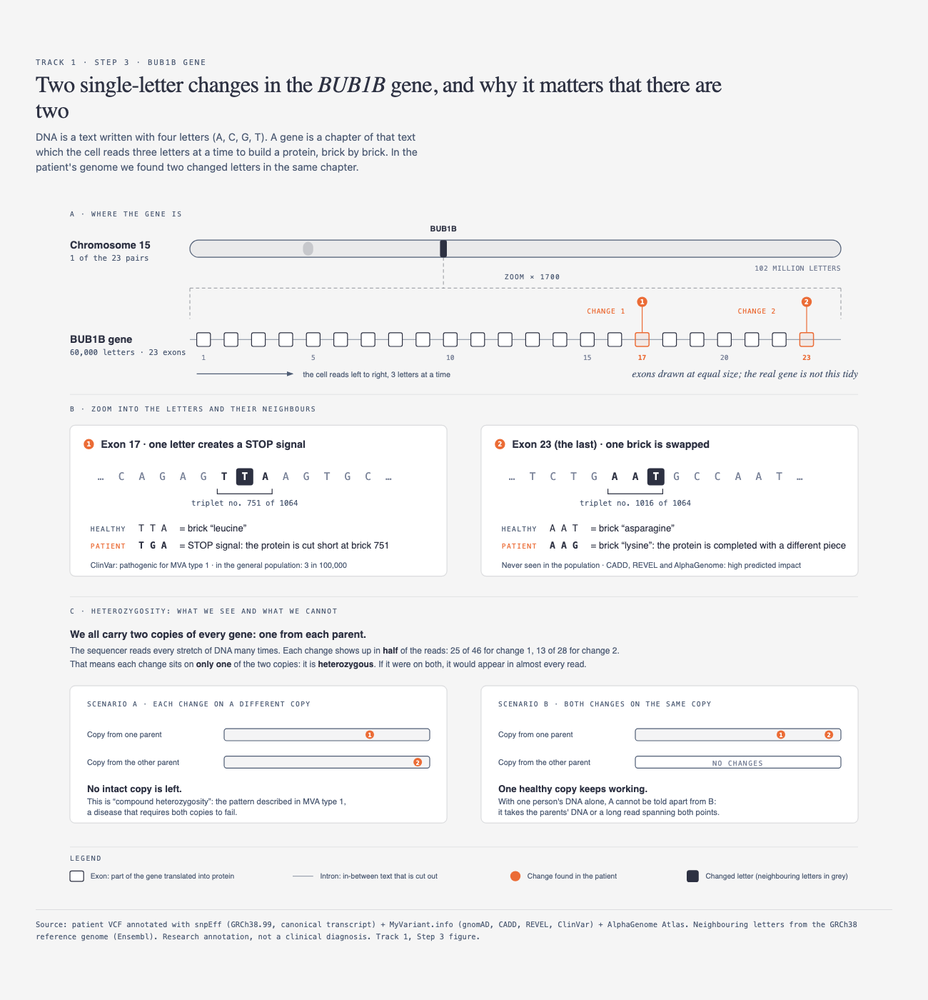
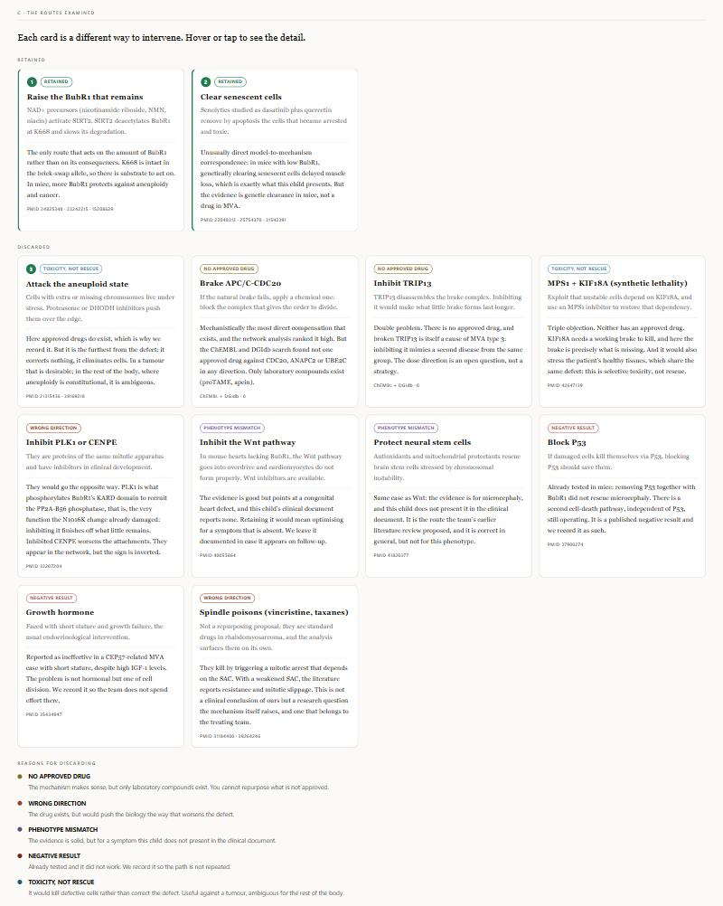

# Findings

This document tracks all new interesting findings and insights (Track 1, Track 2, or secondary), ensuring traceability to the specific notebooks where they were generated.

## Track 1: Phenotype Findings
**Source:** `track1_step1_exp01-hpo_extraction.ipynb`
*   The clinical document directly provided the following HPO terms that outline the patient's severe presentation:
    *   **HP:0002859**: Rhabdomyosarcoma (Cancer)
    *   **HP:0000121**: Nephrocalcinosis (Renal)
    *   **HP:0004322**: Short stature (Growth)
    *   **HP:0001508**: Failure to thrive (Growth)
    *   **HP:0003202**: Skeletal muscle atrophy (Muscle)
    *   **HP:0001622**: Premature birth
    *   **HP:0001518**: Small for gestational age
    *   **HP:0200067**: Recurrent spontaneous abortion (Family History)
*   **Insight:** The presence of *Recurrent spontaneous abortion* in the parents strongly hints at a heritable chromosomal instability issue or aneuploidy running in the family. Furthermore, the *Rhabdomyosarcoma* perfectly matches the literature (found in `00-references.md`) stating that MVA patients are highly susceptible to childhood cancers like Wilms' tumor and rhabdomyosarcoma.

## Track 1: VCF Pre-Filtering Findings
**Source:** `track1_step2_exp01-vcf_prefiltering.ipynb`
*   Applying intrinsic QC filters (GQ>=20, DP>=10, and 'PASS') coupled with a strict Allelic Balance filter (0.30 - 0.70 for heterozygous variants) removes 11.7% of the raw variants.
*   **Insight:** The raw VCF contained 5,012,204 variants. After intrinsic QC, **4,428,273** variants survived (583,931 dropped: 271,414 by `FILTER`, 29,727 by GQ < 20, 34,646 by DP < 10, 248,144 by allelic balance; none lacked metrics or were HOM_REF/unknown). Most of the noise is removed by the common-variant subtraction, not by QC.
*   **Filter 2 (Common Variant Subtraction):** The allele-aware subtraction against dbSNP Common (MAF >= 1%) dropped **3,836,941** common variants (86.6% of the QC survivors). This is the per-allele count from `run_step2_prefilter.py`; the notebook counts per record and reports 3,836,934. Both yield the same 591,339 survivors (see below).
*   **Final Output:** We are left with exactly **591,339 ultra-rare and high-quality variants** (11.8% of the input, saved to `data/track1_step2_rare_variants.vcf.gz`), i.e. 88.2% of the raw VCF is stripped before the annotation phase.
*   **Discrepancy resolved (2026-09-17, macOS re-run of `notebooks/utils/run_step2_prefilter.py`):** an earlier version of this section recorded 2,645,065 QC survivors / 2,264,773 common / 380,292 rare, and `01-procedure.md` recorded "2.64M survived intrinsic QC". Neither set matched the notebook's own cell output. The re-run reproduces the notebook exactly (4,428,273 -> 591,339; the common-dropped count differs by 7 from the notebook's 3,836,934 because the script counts per-allele keys on multi-allelic sites). **591,339 is the figure to rely on.** Runtime on Apple Silicon (M-series, 10 cores): 1.4 min end-to-end vs 405 s for the notebook's per-variant tabix approach.

## Track 1: Environment & Reference-Data Findings
**Source:** `notebooks/utils/run_step2_prefilter.py`, `track1_step4_prioritize.py`, `track1_step5_submission.py`; branch `track1_opt01-macos-portable`
*   **snpEff GRCh38.99 cannot be downloaded any more.** The versioned `snpEff.zip` is SnpEff 4.5covid19 (2020-04-15). Its `download GRCh38.99` targets `downloads.sourceforge.net/.../databases/v4_5/`, which does not exist; SourceForge only hosts `v4_3` builds (GRCh38.86, GRCh38.92, GRCh38.p7.RefSeq), and the newer `snpeff.blob.core.windows.net` repository used by SnpEff 5.x no longer resolves. Resolution: build `GRCh38.99` locally from Ensembl release 99 (`Homo_sapiens.GRCh38.99.gtf.gz`, primary-assembly DNA, CDS and peptide FASTA) with `snpEff build -gtf22`. Same gene set as the historical prebuilt database.
*   **Patient data is gated on Hugging Face.** `SageBio/mva-hackathon-2026-data` returns HTTP 401 anonymously; access requires accepting the gated-access form and an `hf auth login` token. FASTQs (~82 GB) are not needed for Track 1 and were not downloaded.
*   **Leaderboard contract confirmed from the Space's public source** (`evaluation.py`, `tabs/submit_track1.py`): only `proband_id = PROBAND01` is accepted; chromosome strings are compared verbatim and the ground-truth fallback uses the `chr` prefix; max 10 rows; F-max is computed **per variant**, so a compound-het row contributes two predictions at its epcr.
*   **HPO coverage of the MVA panel is partial.** With HPO release 2026-09-01, *BUB1B* and *CEP57* are annotated to only 3 of the patient's 8 terms (HP:0001518 Small for gestational age, HP:0002859 Rhabdomyosarcoma, HP:0004322 Short stature), *TRIP13* to 2, and *MAD2L1BP* to none (it is not in `genes_to_phenotype.txt`). Exact term overlap would therefore rank the true genes low; the Step 4 matcher uses ontology-aware Resnik similarity and the MVA panel is checked explicitly regardless of score. HP:0000121 Nephrocalcinosis, HP:0003202 Skeletal muscle atrophy, HP:0001622 Premature birth and HP:0200067 Recurrent spontaneous abortion have no direct match in any MVA gene.
*   **`requests` was missing from `requirements.txt`** although Step 3A imports it; added (with `huggingface_hub` for data download, `alphagenome`, `python-dotenv` and `pytest`).

## Track 1: Annotation Findings
**Source:** `track1_step3_exp01-vcf_annotating.ipynb`, `notebooks/utils/track1_step3a_annotate.py`, `notebooks/utils/step3b_alphagenome.py` (macOS run output `snpeff_annotated.vcf`, not versioned)
*   **Two Step 3 runs exist, and they disagree on the HIGH/MODERATE count.** The notebook `track1_step3_exp01-vcf_annotating.ipynb` (snpEff `-canon GRCh38.99`, first ANN entry) kept **905** HIGH/MODERATE variants (99.85 % filtered; 719 SNVs, 186 indels; 719 with AVI_PHRED). 712 of them have gnomAD AF > 1 %, so only 193 pass the 1 % frequency cutoff applied in Step 5. The macOS script run (`snpeff_annotated.vcf` via `notebooks/utils/track1_step3a_annotate.py`, locally built GRCh38.99) kept **1,526**, and the bullets below were measured on that run. The cause has not been established; the most likely candidate is a difference between the two snpEff database builds. **Steps 4 and 5, and therefore the submission, consume the notebook's 905-variant output** (`data/track1_step3_annotation_and_filtering.vcf.gz`). The BUB1B finding is identical in both runs; the qualitative conclusions below (dbSNP Common is a weak coding blacklist, AlphaGenome scores SNVs only) hold for both.
*   **(Script run, 1,526 variants.) Only 1,526 of the 591,339 "rare" variants are protein-altering** in the script run (202 HIGH, 1,324 MODERATE on canonical transcripts); 99.5 % of what survives Step 2 is MODIFIER (intronic/intergenic). The procedure's estimate of ~10-20k was an order of magnitude high.
*   **MyVariant.info must be queried with `assembly=hg38`.** (Script run, 1,526 variants.) The original Step 3A queried the default hg19 index with GRCh38 coordinates: 1,492 of 1,526 variants came back "notfound" and the 34 "hits" were different variants that happen to share an hg19 coordinate. With `assembly=hg38`, 1,525/1,526 are found. Any Step 3A output produced before this fix must be discarded.
*   **dbSNP Common (b151, 2018) is a weak blacklist for coding variants.** (Script run, 1,526 variants.) After Step 2, **1,212 of the 1,526 HIGH/MODERATE variants have gnomAD AF > 1 %** (1,163 above 5 %; e.g. chr1:942451 T>C, gnomAD AF 0.9999 — the reference genome carries the minor allele). Spot-checking 300 of the common SNVs against the local `common_all_20180418.vcf.gz` with tabix found **none of them present at all**, so this is not an allele-matching bug in `run_step2_prefilter.py`: the 2018 file simply lacks them. For indels the gap is near-total (278 of 307 have AF > 1 %; dbSNP normalises them differently). Consequence: gnomAD AF from Step 3A is the effective frequency filter, and Step 5 applies the procedure's 1 % cutoff on it (`--max-af 0.01`, not tighter, per `00-references.md` §4). Replacing dbSNP Common with a gnomAD-based blacklist in Step 2 would be the structural fix.
*   **AlphaGenome Atlas scores SNVs only.** `query_variants` raises `NotImplementedError` for every insertion/deletion (alphagenome 0.9.0). (Script run, 1,526 variants.) 1,220/1,526 variants received `AVI_PHRED`; 257 are in the genome-wide top 1 % (Phred >= 20), 13 in the top 0.1 %. The dominant attribution modality for coding variants is conservation (`CACTUS_241_WAY`) followed by `ALPHAMISSENSE`. `TARGET_GENE` is not returned by the AVI scorers.
*   **MVA panel, as seen in the Step 3 output (research annotation, not a clinical statement):** the only panel gene with HIGH/MODERATE rare variants is *BUB1B*, with **two heterozygous variants**:
    *   a **stop-gain** (HIGH), gnomAD genomes AF ~3e-5, CADD 36, AVI_PHRED 33.8 (top modality PROTEIN_TERMINATION), ClinVar **Pathogenic/Likely pathogenic** (single submitter), OMIM 257300 (MVA syndrome 1), allelic balance 0.54;
    *   a **missense** (MODERATE) absent from gnomAD, CADD 24.5, REVEL 0.47, AVI_PHRED 25.6 (top modality ALPHAMISSENSE), no ClinVar record, allelic balance 0.46.
    *   Two heterozygous variants in an autosomal-recessive MVA gene is the compound-heterozygous pattern described for MVA1 in `00-references.md`; phase cannot be determined from a single-sample VCF. No HIGH/MODERATE rare variants in *CEP57*, *TRIP13* or *MAD2L1BP*. The exact coordinates of these two variants (and of the other ranked candidates) appear only where the deliverables require them: the Track 1 submission CSV and the Track 1 methods write-up. The annotated VCFs, which carry the genome-wide genotypes, stay gitignored (repo rule: no patient genotype tables in git).
*   **Figure for non-specialists.** Where the two *BUB1B* changes sit in the gene, what each does to the protein (exon 17: a TTA→TGA codon change creates a premature STOP at residue 751 of 1064; exon 23: AAT→AAG replaces asparagine 1016 with lysine), and what heterozygosity means, including the two phase scenarios (changes on different copies vs. the same copy). Residue numbers follow the snpEff Ensembl-99 canonical transcript (1,064 aa); in UniProt O60566 (1,050 aa) the same residues are Leu737 and Asn1002 (offset −14, verified against the UniProt sequence). The interactive HTML has an English/Español switch at the top right: [`figures/bub1b_variants_explained.html`](figures/bub1b_variants_explained.html) (regenerate with `python docs/figures/build_bub1b_figure.py`).

    

## Track 1: Phenotype Matching & Prioritization (Step 4)
**Source:** `track1_step4_exp01-phenotype_matching.ipynb`
*   **Gene Ranking via HPO Semantic Similarity:** Using the Resnik similarity model based on the extracted patient HPO terms, the pipeline scored each candidate gene. The top 5 matched genes are *CDON* (0.634), *BUB1B* (0.632), *RAI1* (0.620), *PEX5* (0.610), and *ATP8B1* (0.592).
*   **BUB1B Confirmation:** *BUB1B* is uniquely notable because it ranks #2 genome-wide on pure phenotype similarity (0.632 score, 3 exact HPO matches) **AND** carries two rare heterozygous variants (phase unconfirmed): one `HIGH` impact stop-gain mutation and one `MODERATE` missense). Crucially, *BUB1B* is also a Tier 1 MVA panel gene.
*   **Other MVA Panel Genes:** No other Tier 1 MVA genes (*CEP57, TRIP13, MAD2L1BP, CENATAC, CCDC84, CEP192, SMC5, BUB1*) carried rare HIGH/MODERATE variants.
*   **SAC/Centrosome Genes (Tier 2):** Two other genes involved in spindle assembly checkpoint biology carried a single rare heterozygous variant each: *SGO1* and *MAD1L1*. However, they lack biallelic evidence and possess very weak phenotype similarity scores (<0.25).

## Track 1: Ranking and EPCR Scoring (Step 5)
**Source:** `track1_step5_exp01-ranking.ipynb`
*   **Final Ranking:** After integrating phenotype matching, pathogenicity scores (CADD, REVEL, AVI_PHRED, ClinVar), allele frequency (gnomAD), and inheritance modeling into the unified EPCR (Estimated Probability of Causal Relationship) calculation, the **BUB1B compound-heterozygous pair** was confirmed as the top candidate.
*   **Score Separation:** The BUB1B pair achieved an EPCR of **0.9379**, demonstrating a massive separation from the second-ranked candidate (LZTR1, EPCR=0.5627). This confident, separated scoring profile is highly favorable for the leaderboard's F-max calculation.

## Track 2: Establish the variant-specific disease mechanism (Step 1)

Here are the main concepts regarding the variant-specific disease mechanism:

* **Concept 1: The Normal Function of BUBR1 and the Spindle Assembly Checkpoint (SAC)**

    The *BUB1B* gene encodes the BubR1 protein, which is an essential component of the mitotic checkpoint, also known as the Spindle Assembly Checkpoint (SAC) (https://europepmc.org/article/MED/20220147). The SAC is a critical cellular surveillance mechanism that ensures accurate chromosome segregation by facilitating the assembly of the mitotic checkpoint complex (MCC) and promoting its binding to the anaphase-promoting complex/cyclosome (APC/C) (https://europepmc.org/article/PPR/PPR1101323, https://europepmc.org/article/MED/42477419). When kinetochores are incorrectly attached or unattached to the mitotic spindle, BubR1 triggers an anaphase delay, successfully preventing aneuploidy in cellular progeny (https://europepmc.org/article/MED/20220147). 
    
    **Summary:** Think of the cell as a factory preparing to divide its genetic material equally into two new daughter cells. BubR1 acts as a strict safety inspector on the assembly line (the Spindle Assembly Checkpoint). If the chromosomes (the genetic material) are not lined up and attached perfectly, BubR1 hits the emergency stop button, pausing cell division until the errors are fixed. This prevents the new cells from ending up with the wrong number of chromosomes, a dangerous condition called aneuploidy.

* **Concept 2: The Structural Role of the BUBR1 TPR Domain and Kinetochore Interactions**

    The ability of BubR1 to monitor chromosome attachment relies heavily on the molecular architecture of its functionally significant N-terminal region, which contains a tetratricopeptide repeat (TPR) domain (https://europepmc.org/article/MED/20220147). This TPR domain has a highly specific, divergent structure featuring a disordered loop insertion, a 3(10)-helix, and a shallow groove on its concave surface that forms multiple discrete, cooperative interactions with the kinetochore protein Blinkin (https://europepmc.org/article/MED/20220147). Furthermore, regions located C-terminal to the TPR domains mediate a direct interaction between BubR1 and another protein, Bub1, which provides the mechanism required for recruiting BubR1 directly to the kinetochore-microtubule interface (https://europepmc.org/article/MED/20220147).

    **Summary:** Proteins are like complex 3D puzzle pieces that must fit together perfectly to do their jobs. BubR1 has a specific region at one end, called the TPR domain, which acts like a specialized docking port. This port grabs onto other anchor proteins (like Blinkin and Bub1) located at the center of the chromosomes. This precise docking process ensures that our "safety inspector" (BubR1) is positioned in exactly the right spot on the chromosome to monitor the alignment process.

* **Concept 3: MCC Assembly, the "Lasso" Structure, and Downstream APC/C Inhibition**

    Beyond tethering to the kinetochore, the BubR1 TPR domain plays a vital downstream role in SAC signaling by interacting with key checkpoint proteins, including Mad2, Cdc20 (a component of the APC/C), and Apc2 (https://europepmc.org/article/PPR/PPR1101323, https://europepmc.org/article/MED/42477419). Remarkably, the TPR domain forms an intramolecular interaction with downstream residues of the BubR1 protein itself to organize a structure resembling a "lasso" (https://europepmc.org/article/PPR/PPR1101323, https://europepmc.org/article/MED/42477419). This unique lasso shape incorporates four distinct Cdc20-binding elements, significantly enhancing BubR1's engagement with Cdc20 within the APC/C (https://europepmc.org/article/PPR/PPR1101323, https://europepmc.org/article/MED/42477419). Functional and biochemical analyses show that these cooperative interactions promote rapid MCC assembly and MCC-APC/C binding, enabling swift SAC activation in response to attachment defects (https://europepmc.org/article/PPR/PPR1101323, https://europepmc.org/article/MED/42477419). 

    **Summary:** To successfully pause cell division, BubR1 needs to physically block a machine in the cell (the APC/C) that normally gives the "go-ahead" signal. BubR1's docking port folds into a complex shape resembling a lasso. This lasso wraps around and tightly binds to key parts of the "go-ahead" machine, effectively jamming its gears. This jamming action successfully halts cell division the moment a structural problem is detected.

* **Concept 4: Disease Mechanism of MVA via Truncating and Missense Mutations (general MVA1 mechanisms)**

    *This concept summarises how truncating and missense BUB1B mutations act in MVA1 generally. It is not specific to this child's variants: N1016K lies in the C-terminal pseudokinase domain, not the TPR domain (see Concept 5).* In Mosaic Variegated Aneuploidy (MVA), compound heterozygous mutations (a stop-gain and a missense variant) severely compromise the structural and functional integrity of BubR1. A stop-gain (truncating) mutation leads to a severely shortened protein that loses critical C-terminal elements required for Bub1 interaction and kinetochore recruitment (https://europepmc.org/article/MED/20220147). Meanwhile, a missense mutation altering the N-terminal TPR domain disrupts the shallow groove necessary for Blinkin binding (https://europepmc.org/article/MED/20220147), or prevents the formation of the intramolecular "lasso" structure required for interacting with Mad2, Cdc20, and Apc2 (https://europepmc.org/article/PPR/PPR1101323, https://europepmc.org/article/MED/42477419). Because these mutations collectively prevent MCC-APC/C binding and abolish the SAC anaphase delay, cells with incorrect microtubule-kinetochore attachments divide prematurely, resulting in the massive chromosome missegregation and resulting aneuploidy characteristic of MVA (https://europepmc.org/article/MED/20220147, https://europepmc.org/article/PPR/PPR1101323, https://europepmc.org/article/MED/42477419).

    **Summary:** In patients with MVA, individuals typically inherit two different broken copies of the BubR1 gene. (For this child, phase is not confirmed.) The "stop-gain" copy stops building the protein halfway through, creating a useless, shortened piece that cannot attach to the chromosome. The "missense" copy builds the protein, but has a spelling mistake that warps its shape, ruining its special "lasso" meant to jam the division machinery. Because both versions of the safety inspector are broken, the cell can no longer pause division when errors occur. As a result, cells divide carelessly, causing the resulting cells to have random, incorrect numbers of chromosomes, which drives the severe health issues seen in MVA.

* **Concept 5: The Crucial Role of the C-Terminal Pseudokinase Domain and Nonsense-Mediated Decay**

    In the specific context of the Track 1 compound heterozygous mutations (a stop-gain at residue 751 and a missense at residue 1016), the defects localize heavily to the C-terminal pseudokinase domain of BUBR1. Research demonstrates that truncating mutations (like the stop-gain L751*) often trigger nonsense-mediated mRNA decay (NMD), effectively destroying the mutant blueprint and acting as a null allele that halves the total amount of BUBR1 protein in the cell (https://pubmed.ncbi.nlm.nih.gov/16411201/). The remaining protein, produced by the missense allele (N1016K), carries a defect directly inside the pseudokinase domain. While the N-terminal TPR and KEN-box domains handle APC/C inhibition, the C-terminal pseudokinase domain is strictly required to promote the phosphorylation of the KARD (Kinase Attachment Regulatory Domain) and recruit the PP2A-B56 phosphatase to the kinetochore (https://pubmed.ncbi.nlm.nih.gov/33207204/). This phosphatase recruitment is essential for stabilizing kinetochore-microtubule attachments and correctly silencing the SAC. The combination of severely reduced overall protein levels (from NMD of the stop-gain allele) and defective phosphatase recruitment (from the pseudokinase missense allele) precipitates the hallmark premature chromatid separation and extreme aneuploidy seen in MVA.

    **Summary:** The child's specific mutations deliver a "one-two punch" to our safety inspector. The first mutation (the stop-gain) acts like a shredded blueprint; the cell's cleanup system recognizes it is fatally flawed and destroys it, leaving the cell with only half the usual number of inspectors. The second mutation (the missense) builds an inspector, but with a broken "radio" (the pseudokinase domain at the tail end of the protein). While this inspector might still dock at the chromosome, it cannot call in the repair crew (the PP2A-B56 phosphatase) needed to stabilize the chromosome's cables and safely finish cell division. With too few inspectors overall, and the remaining ones unable to call for help to finish the job, the cell divides chaotically.

## Track 2: Map the disease mechanism to therapeutic targets (Step 2)

### 1. Compensating for SAC Failure by Inhibiting the APC/C-CDC20 Axis

**Scientific Explanation:** 
BUB1B/BUBR1 forms a critical part of the Mitotic Checkpoint Complex (MCC), which functions to inhibit the Anaphase-Promoting Complex/Cyclosome (APC/C) and its activator CDC20, thereby delaying mitotic exit (https://europepmc.org/article/MED/39614058). Because BUBR1 deficiency leads to a weakened Spindle Assembly Checkpoint (SAC) and premature mitotic exit, pharmacological inhibition of APC/C and CDC20 represents a direct strategy to force mitotic arrest and compensate for this loss. Inhibitors such as Apcin, proTAME, and novel D-box peptide inhibitors directly target and block CDC20 activity (https://europepmc.org/article/MED/39614058; https://europepmc.org/article/MED/40888475). Combining Apcin with the pan-CDK inhibitor ZK304709 suppresses CDC20 expression and prevents compensatory CDK1 activation, synergistically inducing G2/M phase arrest (https://europepmc.org/article/MED/41416401). Other novel compounds include the CDC20/HSP90 dual-inhibitor 2b and the Apcin analogue 14c, which potently inhibit CDC20 and halt the growth of defective cells (https://europepmc.org/article/MED/41103026; https://europepmc.org/article/MED/40020424). Upstream regulatory targets are also actionable: CCT5 facilitates the turnover of the MCC-CDC20-APC/C complex, and its genetic depletion successfully induces G2/M arrest (https://europepmc.org/article/MED/41890968). Furthermore, targeting the E2 ubiquitin-conjugating enzyme UBE2C with the novel compound Halorotetin B blocks the ubiquitin-mediated degradation of cyclin B1, enforcing cell cycle arrest (https://europepmc.org/article/MED/41387196). Treatment with the APC/C antagonist proTAME after SAC disruption has been studied for its effect on chromosome segregation, but only in mouse oocytes (Yonekura et al. 2025, https://europepmc.org/article/MED/40887771); there is no evidence in somatic or BubR1-deficient cells.

**Summary:** 
Think of the cell cycle like a car approaching an intersection. Normally, BUBR1 acts like the car's brakes, forcing the cell to pause and wait until all of its chromosomes are perfectly aligned before dividing. In MVA, the brakes are broken, causing the cell to speed through division and distribute its genetic material incorrectly. Scientists can fix this by taking their foot off the "gas pedal" of cell division—a complex called APC/C and its activator protein, CDC20. By using specific drugs to block APC/C, CDC20, or related proteins, researchers can artificially slow down the cell cycle. This forces the cell to pause, granting it the time needed to align its chromosomes properly and preventing the creation of heavily mutated cells.

### 2. Restoring Kinetochore Balance via Aurora B, PP2A-B56, and PICH Modulation

**Scientific Explanation:** 
During mitosis, BUBR1 plays an essential role in stabilizing kinetochore-microtubule attachments by recruiting the PP2A-B56 phosphatase via its conserved LxxIxE motif, which balances out Aurora kinase hyperphosphorylation (https://europepmc.org/article/MED/38542160; https://europepmc.org/article/MED/40684918; https://europepmc.org/article/MED/41120314). The loss of BUBR1 prevents CENP-E from countering Aurora B-mediated phosphorylation, thereby delaying end-on chromosome attachments and causing spindle errors (https://europepmc.org/article/MED/41120314). Furthermore, Aurora B kinase-mediated phosphorylation is essential for the acetylation of BUBR1 at lysine 250, a crucial modification needed to preserve the MCC and the fibrous corona via CENP-E (https://europepmc.org/article/MED/41533580). Expression of an acetyl-mimetic BUBR1 is capable of rescuing these SAC defects (https://europepmc.org/article/MED/41533580). Consequently, therapeutic modulation of Aurora B or targeted manipulation of the PP2A-B56 holoenzyme could restore the equilibrium between kinase and phosphatase activity. Additionally, the chromatin remodeling enzyme PICH regulates the abundance of SUMOylated chromosomal proteins; its inhibition increases Bub1 association at the kinetochore, which extends SAC activation (https://europepmc.org/article/MED/39919802). 

**Summary:** 
For a cell to divide successfully, microscopic "cables" must attach securely to the chromosomes to pull them apart. This connection is controlled by a delicate balance of "on" and "off" chemical switches—specifically, a protein called Aurora B and a protein called PP2A. BUBR1 is essential for bringing the "off" switch to the right location. Without it, the "on" switch (Aurora B) becomes hyperactive, making the cables unstable. Drugs that either quiet down Aurora B, mimic the chemical changes it causes, or block other enzymes like PICH can help restore this delicate balance. This helps the chromosomes lock onto the cables firmly, rescuing the cell's ability to divide evenly.

### 3. Exploiting the MCC Disassembly Pathway via TRIP13 Inhibition

**Scientific Explanation:** 
The MCC is a highly dynamic structure, and its continuous disassembly is actively driven by the AAA+ ATPase family member TRIP13 (https://europepmc.org/article/MED/37800638). In conditions where MCC formation is severely impaired—such as the BUB1B/BUBR1 deficiency seen in MVA—the SAC surveillance system malfunctions due to a lack of intact inhibitory complexes. Inhibiting TRIP13 prevents the disassembly of the MCC, thereby stabilizing the remaining checkpoint complexes and enhancing overall SAC surveillance (https://europepmc.org/article/MED/37800638). Pharmacologically targeting TRIP13 provides a direct compensatory strategy to rescue SAC dysfunction by ensuring that any MCC formed in the BUBR1-deficient environment remains intact long enough to delay anaphase.

**Summary:** 
Inside the cell, there is a specialized "recycling machine" called TRIP13 that is programmed to break down the cell's safety signals once division is ready to proceed. Because patients with MVA have a genetic defect, they struggle to generate enough of these safety signals in the first place. By using drugs to block the TRIP13 recycling machine, the few safety signals the cell *does* manage to make will stick around for much longer. This artificially boosts the cell's alarm system, helping it to pause properly before dividing.

### 4. Navigating Spindle Motor Dependencies and MPS1 Vulnerabilities

**Scientific Explanation:** 
Chromosomally unstable cells are generally sensitive to the inhibition of the kinesin motor KIF18A (e.g., using the inhibitor ATX020) and the SKA complex (https://europepmc.org/article/MED/41369352; https://europepmc.org/article/PPR/PPR1235559). However, successful KIF18A inhibition strictly requires a competent SAC to induce mitotic arrest; therefore, SAC-deficient cells (like those missing functional BUBR1) fail to arrest and survive KIF18A monotherapy (https://europepmc.org/article/MED/42647139; https://europepmc.org/article/MED/42328720). Strikingly, transient induction of acute chromosomal instability using inhibitors against the SAC kinase MPS1 (TTK) can partially restore sensitivity to KIF18A inhibitors in these resistant models (https://europepmc.org/article/MED/42647139). Furthermore, MPS1 inhibition acts as a potent synthetic lethal vulnerability in cells with high basal CDC20 expression or those lacking PRR14L, a scaffold protein intimately linked to the PP2A-B56 complex and TACC3 (https://europepmc.org/article/MED/39838194; https://europepmc.org/article/PPR/PPR1114839; https://europepmc.org/article/MED/42160513). Targeting these specific cell cycle vulnerabilities offers a refined strategy to exploit the disrupted mitotic checkpoints (https://europepmc.org/article/MED/42222984).

**Summary:** 
Scientists have designed drugs that target a motor protein called KIF18A to selectively kill genetically unstable cells. However, these drugs have a catch: they only work if the cell's internal alarm system is fully operational. Because cells lacking BUBR1 have a broken alarm system, KIF18A drugs don't work on them directly. But researchers found a clever workaround. By briefly giving the cells a second drug that targets a different protein called MPS1, they can reset the cell's vulnerability. Using these drugs together creates a specific one-two punch that bypasses the broken alarm system and successfully destroys the defective cells.

### 5. Targeting the Aneuploid State via Metabolic and Proteotoxic Synthetic Lethality

**Scientific Explanation:** 
Because BUBR1 deficiency inevitably results in widespread aneuploidy, an alternative therapeutic strategy involves focusing downstream to selectively eliminate these chromosomally abnormal cells via synthetic lethality (https://europepmc.org/article/MED/42760281; https://europepmc.org/article/MED/42137044). Aneuploid cells endure severe proteotoxic and transcriptional stress, making them disproportionately reliant on RNA degradation pathways and rendering them exquisitely sensitive to proteasome inhibitors (https://europepmc.org/article/MED/39247952). Combining APC/C inhibitors like proTAME with HSP90 inhibitors exacerbates this proteotoxic stress by forcing cell overgrowth, causing misfolded proteins to accumulate fatally (https://europepmc.org/article/MED/40650052). Metabolically, aneuploid cells exhibit a heightened dependency on pyrimidine biosynthesis and mitochondrial oxidative phosphorylation to combat nucleotide pool insufficiency, offering highly targetable metabolic vulnerabilities (https://europepmc.org/article/MED/40324880; https://europepmc.org/article/PPR/PPR918366). From a genomic standpoint, aneuploid cells display a mutual exclusivity with POLE exonuclease mutations, meaning selective inhibition of POLE exonuclease selectively kills highly aneuploid cell lines while sparing healthy diploid cells (https://europepmc.org/article/MED/42258764). Finally, modulating hypoxia pathways via HIF1A inhibition has been shown to decrease the survival proportion of aneuploid cells in mosaic environments (https://europepmc.org/article/MED/41086100).

**Summary:** 
When the BUBR1 gene is broken, the body produces cells with the wrong number of chromosomes, a condition known as aneuploidy. These mutated cells are incredibly stressed because they have to process abnormal amounts of DNA and proteins, and they require massive amounts of energy just to survive. Scientists can use this stress as a weapon. Drugs that block the cell's waste disposal system (the proteasome), disrupt its unique energy production, or block specific DNA repair enzymes (like POLE), could push these already-stressed cells over the edge. In models, this hits the highly abnormal cells harder than normal cells, though not without effects on normal tissue.
### 6. Protecting Neural Stem Cells via Mitochondrial and Proteostasis Support

**Scientific Explanation:** 
In chromosomal instability-induced microcephaly, aneuploid neural stem cells (NSCs) face massive proteotoxic and mitochondrial stress. This energy overload causes NSCs to die or prematurely exit the cell cycle, directly contributing to microcephaly. Treatment with ROS scavengers, mitochondrial chaperones, or apoptosis inhibitors can partially rescue the survival and proliferation of these stressed stem cells (https://pubmed.ncbi.nlm.nih.gov/41820377/).

**Summary:** 
Brain stem cells in MVA are overworked because they have to deal with abnormal proteins and damaged mitochondria. Providing the cells with antioxidants (ROS scavengers) or drugs that protect mitochondria can help keep these essential cells alive and potentially reduce the severity of microcephaly.

### 7. Dual Vulnerabilities in Neural Apoptosis (P53-Independent Pathways)

**Scientific Explanation:** 
While the P53 pathway is a classical driver of apoptosis in chromosomally damaged cells, genetic deletion of P53 in BubR1-deficient mice fails to fully rescue microcephaly. This indicates that a distinct, P53-independent cell death pathway is also actively killing aneuploid cortical cells (https://pubmed.ncbi.nlm.nih.gov/37900274/).

**Summary:** 
Simply blocking the cell's main "suicide" switch (P53) isn't enough to save brain cells in MVA. Any therapeutic approach targeting cell death must consider that these damaged cells use multiple, parallel pathways to self-destruct.

### 8. Suppressing Hyperactive Wnt Signaling to Prevent Congenital Heart Defects

**Scientific Explanation:** 
MVA patients often present with congenital heart defects (e.g., septal defects). Single-cell analysis of BubR1-deficient models reveals that cardiomyocytes fail to develop properly because the Wnt signaling pathway becomes aberrantly hyperactive, suppressing key cardiogenesis regulators (https://pubmed.ncbi.nlm.nih.gov/40055864/).

**Summary:** 
The genetic defect in MVA throws a major communication system—the Wnt pathway—into overdrive in the developing heart, preventing it from forming correctly. Using existing drugs to quiet down the Wnt pathway could be a targeted strategy for the cardiovascular complications of MVA.

**Output: A short list of prioritized therapeutic nodes, each linked to a specific mechanistic rationale and evidence level.**
- **TRIP13**: *Rationale*: Compensates for impaired MCC formation by stabilizing existing complexes to boost the SAC alarm system. *Evidence*: High (Direct functional compensation in SAC-deficient context).
- **MPS1 (TTK) + KIF18A**: *Rationale*: Bypasses SAC deficiency via synthetic lethality; MPS1 inhibition restores KIF18A dependency in chromosomally unstable cells. *Evidence*: High (Strong synthetic lethality mechanism in aneuploid models).
- **Proteasome / APC/C (e.g., CDC20/FZR1)**: *Rationale*: Exploits the massive downstream proteotoxic stress of aneuploid cells, driving them to apoptosis while sparing normal cells. *Evidence*: Medium/High (Well-characterized dependency in highly aneuploid cells).
- **Wnt Signaling Pathway**: *Rationale*: Reverses hyperactive signaling responsible for failed cardiomyocyte development in BubR1 deficiency. *Evidence*: Medium (Validated in in-vivo BubR1-deficient heart models).
- **Mitochondrial ROS / Proteostasis**: *Rationale*: Protects vulnerable neural stem cells from energy-depletion-induced death, addressing microcephaly. *Evidence*: Medium (Proven rescue of NSC pools in vivo).

> **Revised in Step 3.** Four of these five nodes did not survive the mapping to approved drugs, and the fifth (proteasome / aneuploid state) survives only as a low-ranked research direction (rank 3 in Step 4). TRIP13, MPS1/KIF18A and APC/C-CDC20 have **no approved drug in any direction**; Wnt and neural-stem-cell protection target phenotypes (congenital heart defect, microcephaly) that **this child does not present** in the clinical document. See below.
>
> **Where the final hypotheses come from.** The two hypotheses prioritised in Step 4 — NAD+/SIRT2 BubR1 stabilisation (H1) and senescent-cell clearance (H2) — are not in the list above. This Step 2 network was built around the mitotic machinery, and missed two arms of BubR1 biology that do not run through mitosis: *dosage* (BubR1 abundance is regulated by SIRT2/NAD+, and raising it protects against aneuploidy in mice) and *senescence* (low BubR1 drives p16-positive senescent-cell accumulation). Both were added during Steps 3-4; the evidence is in `00-references.md` §4 and §5.

## Track 2: Map targets to approved drugs (Step 3)
**Source:** `notebooks/utils/track2_step3_drug_mapping.py`, `notebooks/utils/track2_target_panel.tsv`

A panel of **35 candidate proteins** was assembled from the Step 2 analysis, each annotated with its relationship to BUB1B (direct interactor / same pathway / MVA gene / indirect CIN biology), the **desired direction of modulation**, and the therapeutic concept it serves. The panel lives in its own TSV rather than in code, so the reasoning for each inclusion can be reviewed and revised without touching the pipeline.

Each gene was resolved to its reviewed human UniProt accession, then mapped to approved drugs through **ChEMBL** (primary; curated mechanisms of action), cross-checked against **DGIdb**, with **STRING** used for network distance to BUB1B as supporting evidence only.

*   **Implementation note that changes the result:** ChEMBL must be queried through *every* target containing the protein, not just `SINGLE PROTEIN` entries. Bortezomib is annotated against the target "26S proteasome", not against PSMB5; querying single proteins alone would have returned zero drugs for that node. Salts and hydrates are collapsed to their parent molecule (`IXAZOMIB CITRATE` → `IXAZOMIB`) so approval phase is not under-reported.

*   **A mis-annotation worth recording:** ChEMBL annotates the rapalogs (sirolimus, everolimus) against **FKBP12/FKBP1A**, the protein they bind, not against MTOR. A panel listing only MTOR silently misses them. FKBP1A was added to the panel for this reason; it contributes five approved concordant drugs (everolimus, pimecrolimus, sirolimus, tacrolimus, temsirolimus) at STRING distance 3. The counts below include it (re-run 2026-10-13).

### The central finding: proximity and druggability are inversely related

| Relationship to BUB1B | Genes | Genes with an approved concordant drug |
|---|---|---|
| Direct interactor | 10 | **0** |
| Same pathway | 7 | **0** |
| MVA gene (BUB1B, TRIP13) | 2 | **0** |
| Indirect CIN biology | 16 | 8 |

All **18 proteins at STRING distance 1 from BUB1B** — CDC20, TRIP13, TTK, AURKB, PLK1, BUB1, BUB3, MAD2L1, CENPE, NDC80, SGO1, ESPL1, UBE2C, ANAPC2, MAD1L1, KIF18A, PPP2CA, FOXM1 — have **zero** approved direction-concordant drugs. Every one of the 26 approved concordant drugs identified acts on a protein at **distance 2-3** (PSMB5, BCL2, SRC, MTOR at 2; ABL1, FKBP1A at 3) or with **no STRING path** to BUB1B at all (DHODH, POLE).

*   **Why this matters:** the mitotic machinery is essentially undrugged in the approved pharmacopoeia, because inhibiting it is only ever desirable in oncology, and there the development path has mostly failed. The practical consequence for Track 2 is that **no approved drug acts on the defect itself**. Every available candidate acts on a consequence. This reframes the task: not "which drug fixes the checkpoint" — none does — but "which consequence is worth addressing, and is the evidence for doing so honest".

*   **Direction matters as much as availability.** PLK1 and CENPE have inhibitors in clinical development and appear prominently in the network, but the direction is inverted: PLK1 phosphorylates BubR1's KARD domain to recruit PP2A-B56, which is precisely the function the N1016K pseudokinase variant already compromises. Inhibiting PLK1 would remove what little recruitment remains. Availability without directionality is not a candidate.

### The routes examined, and why each was retained or discarded

Interactive version with an English/Español switch: [`figures/track2_mechanisms_explained.html`](figures/track2_mechanisms_explained.html) (regenerate with `python docs/figures/build_track2_mechanisms_figure.py`). It also covers the healthy SAC mechanism and what the two patient variants break, for readers who are not specialists.

Discard reasons fall into five distinct categories, which is itself the useful output — they are not all "it doesn't work":

| Reason | Routes |
|---|---|
| **No approved drug exists** | APC/C-CDC20, TRIP13 |
| **Wrong direction** | PLK1 / CENPE inhibition; spindle poisons |
| **Phenotype does not match this child** | Wnt inhibition (heart), neural stem cell protection (microcephaly) |
| **Published negative result** | P53 blockade; growth hormone |
| **Toxicity, not rescue** | MPS1+KIF18A; targeting the aneuploid state |

*   **The phenotype-mismatch discards are the most consequential revision to Step 2.** The clinical document for this child lists rhabdomyosarcoma, nephrocalcinosis, short stature, failure to thrive, skeletal muscle atrophy, premature birth, small for gestational age, and parental recurrent miscarriage. It lists **no microcephaly and no congenital heart defect**. The two mechanisms the earlier literature review proposed (`00-references.md` Track 2 §2A and §2C) are well-evidenced but target exactly those two absent features. Retaining them would optimise for a phenotype this child does not have.

**Summary**: 
When searching for approved drugs to help this child, we checked 35 proteins related to the defective *BUB1B* gene. We discovered a major challenge: there are no approved drugs that directly fix the core biological problem (the cell division machinery). The drugs that do exist either work in the wrong direction or only address "downstream" consequences. We evaluated several indirect treatment routes but discarded most of them because they are too toxic, lack approved drugs, or target symptoms that this specific child doesn't actually have (like heart or brain defects). This narrowed our focus to a few indirect options that might safely address the child's true symptoms.

## Track 2: Integrate evidence and prioritise (Step 4)
**Source:** `notebooks/utils/track2_step4_prioritize.py`, `notebooks/utils/track2_step4_candidates.tsv`

Each surviving hypothesis is scored 0-3 on the five axes the procedure specifies, combined as a transparent weighted sum. The weights encode the procedure's own rule — a drug is not prioritised merely because it interacts with something in the BUB1B pathway — so mechanistic relevance (0.35) and directionality (0.20) dominate, and tractability alone (0.10) cannot carry a candidate. Axes that do not apply are dropped from the denominator rather than scored zero.

No model was trained: there is no labelled outcome data for MVA repurposing, so a fitted model would be unvalidatable. The weights are stated explicitly so a reader can disagree with them and recompute.

| Rank | ID | Hypothesis | Concept | Score | Mech. | Dir. | Exp. | Human | Tract. |
|---|---|---|---|---|---|---|---|---|---|
| 1 | H1 | **NAD+ precursors → SIRT2 → BubR1 stabilisation** | functional compensation | **0.817** | 3 | 2 | 2 | 2 | 3 |
| 2 | H2 | **Senescent-cell clearance** | phenotype modulation | **0.667** | 2 | 2 | 2 | 2 | 2 |
| 3 | H5 | Targeting the aneuploid state | vulnerability | 0.583 | 1 | 2 | 2 | 2 | 3 |
| 4 | H4 | APC/C-CDC20 braking | downstream correction | 0.483 | 3 | 1 | 1 | 0 | 0 |
| — | H3 | Spindle-poison interaction | *research question, not a candidate* | 0.854 | 3 | n/a | 2 | 2 | 3 |

*   **H1 (NAD+/SIRT2) is the only hypothesis that acts on the cause.** It raises the amount of BubR1 rather than managing a downstream effect. The mechanistic argument depends on one inference worth stating plainly: K668, the residue SIRT2 acts on, lies outside both patient variants, and the stop-gain allele is expected to be destroyed by NMD — so the protein from the missense allele is the plausible substrate. That is a domain-position argument, not an experimental result for N1016K, and the proposed experiment tests it directly.

*   **H1 also carries the sharpest internal tension in the whole analysis.** BUB1B is a dependency of rhabdomyosarcoma cells (PMID 23002205), and this child has had a rhabdomyosarcoma. Raising BubR1 systemically in a cancer-predisposition background is mechanistically unresolved — the same intervention that might stabilise mitosis in healthy tissue could support tumour-cell proliferation. The proposed experiment includes matched RMS lines specifically to separate these two effects. This is recorded as an open contradiction rather than a caveat, because it could invalidate the hypothesis.

*   **H2 (senescence) has the most direct model-to-phenotype match in the analysis.** Genetic clearance of senescent cells in the BubR1-hypomorphic mouse delayed *sarcopenia* — and muscle atrophy with failure to thrive is documented in this child's record. But the evidence is genetic clearance in mice, not a drug, and not in MVA; and senescence is tumour-suppressive, which cuts against use in a cancer-predisposition background.

*   **H5 is the worked example of why tractability cannot carry a hypothesis.** It has the best drug availability of any route (proteasome and DHODH inhibitors, all approved) and the lowest mechanistic relevance (score 1). It corrects nothing — it eliminates aneuploid cells, in a body where aneuploidy is constitutional. Ranked third, and documented as a research direction rather than a prioritised candidate.

*   **H4 is retained as a documented negative result.** Mechanistically it is the most direct compensation that exists, and Step 2 ranked it highly, but the ChEMBL and DGIdb search returned no approved drug against CDC20, ANAPC2 or UBE2C in any direction. Recording the druggability gap is more useful than silently dropping the node.

*   **H3 scores highest but is excluded from the ranking by design.** It is not a repurposing proposal: it is a question about how a weakened checkpoint interacts with spindle poisons already standard in rhabdomyosarcoma treatment. It is flagged separately so the number is not misread as a recommendation; any clinical interpretation belongs to the treating team.

**Summary**: 
We scored our final treatment ideas based mostly on how directly they fix the underlying biology, rather than just how easy it is to find a drug. The top-ranked idea is to use NAD+ precursors to help stabilize the small amount of working BubR1 protein the child still produces. However, there is a major catch: while boosting this protein might help healthy cells divide normally, it could accidentally help cancer cells grow too (a serious risk given the child's history of tumors). Our second best idea is clearing out damaged ('senescent') cells to help with muscle wasting, but this also carries cancer-related risks. Ultimately, any potential treatment requires careful lab testing to ensure we don't accidentally encourage cancer growth while trying to fix the genetic defect.

### Reproducibility notes
*   **UniProt accessions are cached on disk** (`notebooks/utils/track2_uniprot_accessions.json`). The service throttles bursts and returned HTTP 500 partway through a run; the cache makes re-runs stable and the mapping reproducible offline.
*   **FKBP1A is now resolved and cached** (P62942, re-run 2026-10-13). The re-run also applied the salt/hydrate collapse to rows produced before it existed (e.g. ABL1 now lists 8 parent drugs instead of 10 salt-form entries) and refreshed DGIdb counts. The Step 4 ranking and scores are unchanged.
*   No patient data is used anywhere in Track 2. All inputs are public database queries and the gene identity from Track 1.

## Track 2: Follow-Up Investigations to Mitigate Candidate Drawbacks
**Source:** Literature review (PubMed) + live drug-database queries: ChEMBL (`https://www.ebi.ac.uk/chembl/api/data`), DGIdb GraphQL (`https://dgidb.org/api/graphql`)

Both top-ranked hypotheses carry mechanistic tension with this child's rhabdomyosarcoma (RMS) history:

*   **H1 (NAD+ precursors → SIRT2 → BubR1 stabilisation)** raises BubR1 systemically in a cancer-predisposition background where RMS cells depend on the FoxM1–Bub1b axis.
*   **H2 (senescent-cell clearance)** removes `p16Ink4a+` cells whose irreversible arrest is itself a tumour-suppressive barrier.

This step asks whether a *secondary* pharmacological strategy — either a co-administered drug or a different drug class — can mitigate those drawbacks. It is an extension of Steps 3–4, not a replacement: H1 and H2 keep their scores and ranks.

### 1. Why antagonistic polypharmacy for H1 does not work, and what replaces it

*   **The contradiction is mechanistic, not just pharmacological.** H1 raises NAD+ and stabilises residual BubR1 to restore SAC fidelity and prevent *new* aneuploidy — an effect that *prevents* tumourigenesis when BubR1 is overexpressed ([Baker et al. 2013, *Nat Cell Biol*](https://pubmed.ncbi.nlm.nih.gov/23242215/)). But *established* RMS cells depend on the FoxM1–Bub1b axis to survive mitotic stress ([Wan et al. 2012, *Cancer Res*](https://pubmed.ncbi.nlm.nih.gov/23002205/)), and tumour cells rely on the cellular NAD+ pool built by NAMPT/NAPRT, so NAD+ *depletion* is itself an antitumour strategy ([Navas et al. 2023, *J Exp Clin Cancer Res*](https://pubmed.ncbi.nlm.nih.gov/36864434/), which showed that supplying NA, NMN or NAD restores tumourigenic and stemness properties to NAMPT-inhibited cells).
*   **Therefore a co-administered "safety" inhibitor is self-defeating.** Adding a compound that blocks BubR1/FoxM1 signalling or depletes NAD+ (e.g. a NAMPT inhibitor) cancels the rescue mechanism in the healthy dividing tissues the hypothesis is meant to protect, while adding continuous systemic toxicity in a child with documented **nephrocalcinosis (HP:0000121)** and **failure to thrive (HP:0001508)**. The two arms cannot be dosed independently because one is the other's off-target.
*   **What makes sense instead — timing, gated on a documented tumour-free interval.** The relevant clinical precedent is not a drug combination but a *population*: children and adults with constitutional genomic-instability syndromes that also carry high malignancy risk.
    *   **Ataxia-telangiectasia (A-T):** NR was tolerated with no adverse effects over 4 months in 24 patients ([Veenhuis et al. 2021, *Mov Disord*](https://pubmed.ncbi.nlm.nih.gov/34515380/)), and a 2-year open-label trial in patients of all ages found NR safe and well tolerated, with NAD+ rising and stabilising in peripheral blood ([Presterud et al. 2024, *Mov Disord*](https://pubmed.ncbi.nlm.nih.gov/37899683/)).
    *   **Werner syndrome:** a double-blind, randomised, crossover, placebo-controlled trial of NR 1000 mg/day for 26 + 26 weeks reported **no serious adverse events**; secondary endpoints showed improved arterial stiffness and, notably, a **significant decrease in blood creatinine**, interpreted as likely suppression of renal functional decline ([Shoji et al. 2025, *Aging Cell*](https://pubmed.ncbi.nlm.nih.gov/40459998/)). In a child whose phenotype includes nephrocalcinosis, a renal-function signal is directly relevant rather than incidental.
    *   **What these trials do *not* show:** neither syndrome is MVA, neither trial measured BubR1, and neither was powered for tumour incidence. They establish tolerability and a monitoring precedent, not efficacy.
*   **Actionable refinement for H1:** reframe it as a **remission-maintenance hypothesis** — considered only after confirmed complete oncological remission, never during active tumour burden — and gate it on the paired in-vitro screen already specified (isogenic `BUB1B` L751*/N1016K cells vs matched RMS lines). This does not remove the contradiction; it converts it into an explicit clinical precondition plus a laboratory go/no-go.

### 2. Senomorphics (SASP suppression) as a safer alternative for the H2 drawback

*   **Why a senomorphic mitigates what a senolytic cannot.** Senolytics (dasatinib + quercetin, fisetin) kill senescent cells by disabling their anti-apoptotic networks ([Zhu et al. 2015, *Aging Cell*](https://pubmed.ncbi.nlm.nih.gov/25754370/)). Genetic clearance of `p16Ink4a+` cells delayed sarcopenia in the BubR1-hypomorphic mouse ([Baker et al. 2011, *Nature*](https://pubmed.ncbi.nlm.nih.gov/22048312/)), but the same cell state is a cell-autonomous barrier to malignant progression ([Di Micco et al. 2021, *Nat Rev Mol Cell Biol*](https://pubmed.ncbi.nlm.nih.gov/33328614/); [Colucci et al. 2025, *Cancer Cell*](https://pubmed.ncbi.nlm.nih.gov/40513577/)). **Senomorphics** are defined as compounds that suppress senescence markers — above all the SASP — without killing the cell ([Zhang et al. 2023, *FEBS J*](https://pubmed.ncbi.nlm.nih.gov/35015337/)). They therefore retain the proliferative lock on damaged cells while silencing the `IL-1α`/`IL-6`/`NF-κB` secretome that drives both muscle wasting and paracrine tumour promotion.
*   **Rapalogs (sirolimus, everolimus, temsirolimus) are the strongest senomorphic follow-up.** Two independent studies showed mTORC1 inhibition selectively blunts the SASP: rapamycin suppresses translation of membrane-bound `IL1A`, reducing `NF-κB` activity ([Laberge et al. 2015, *Nat Cell Biol*](https://pubmed.ncbi.nlm.nih.gov/26147250/)), and mTOR controls `MAPKAPK2`/MK2 translation via 4EBP1, restoring `ZFP36L1`-mediated decay of SASP transcripts ([Herranz et al. 2015, *Nat Cell Biol*](https://pubmed.ncbi.nlm.nih.gov/26280535/)). Critically for the H2 drawback, Laberge et al. also found that rapamycin **suppressed the ability of senescent fibroblasts to stimulate tumour growth in mice** — the opposite of the oncogenic risk that complicates senolysis.
    *   **Pediatric feasibility is already partly established.** Temsirolimus has been tested in a Children's Oncology Group phase 3 trial in intermediate-risk RMS (ARST1431, 297 evaluable patients), where adding it to VAC/VI did **not** improve 3-year event-free survival and increased grade 3–4 anaemia ([Gupta et al. 2024, *Lancet Oncol*](https://pubmed.ncbi.nlm.nih.gov/38936378/)). That is a negative efficacy result in RMS, not a safety failure — and it means an RMS safety dataset in children exists for this class.
*   **Two further approved senomorphic classes, with child-specific caveats.**
    *   **Metformin** blocks SASP gene expression by preventing `IKKα/β` phosphorylation and `NF-κB` nuclear translocation, independently of AMPK, and conditioned medium from metformin-treated senescent cells no longer stimulated prostate cancer cell growth ([Moiseeva et al. 2013, *Aging Cell*](https://pubmed.ncbi.nlm.nih.gov/23521863/); reviewed in [Kulkarni et al. 2020, *Cell Metab*](https://pubmed.ncbi.nlm.nih.gov/32333835/)). Its pharmacology is otherwise attractive here — oral, non-cytotoxic, used in children — **but ChEMBL flags an FDA black-box warning for lactic acidosis**, which is a direct concern against a background of renal impairment from **nephrocalcinosis (`HP:0000121`)**. This makes it a lower-priority senomorphic for this specific child than a low-dose rapalog.
    *   **Ruxolitinib** suppresses SASP production in senescent human cells and, given for 10 weeks to aged mice, alleviated adipose and systemic inflammation and improved physical function ([Xu et al. 2015, *PNAS*](https://pubmed.ncbi.nlm.nih.gov/26578790/)); the paper itself names ruxolitinib. It carries the JAK-inhibitor class boxed warnings (serious infection, malignancy, thrombosis) and dose-limiting cytopenias, so immunosuppression would have to be weighed against tumour surveillance.
*   **Drug-database mapping of the senomorphic candidates (live ChEMBL + DGIdb queries, 2026-10-14):**

| Drug (parent) | ChEMBL ID | First approval | Annotation route | ChEMBL mechanism | DGIdb approved interactions (score) | Advantage over senolysis | Limitation for this child |
|---|---|---|---|---|---|---|---|
| **Sirolimus** | `CHEMBL413` | 1999 | `FKBP1A` (`P62942`) / `MTOR` (`P42345`) | FK506-binding protein 1A inhibitor | `FKBP1A` 0.312; `MTOR` 0.054 | Blunts SASP *and* blocks senescent-cell-driven tumour growth (PMID 26147250) | No `BubR1`-mouse senomorphic test; immunosuppressive at high dose |
| **Everolimus** | `CHEMBL1908360` | 2009 | `FKBP1A` / `MTOR` | FK506-binding protein 1A inhibitor | `FKBP1A` 0.310; `MTOR` 0.136 | Same mechanism; oral pediatric approval exists (SEGA) | Same evidence gap |
| **Temsirolimus** | `CHEMBL1201182` | 2007 | `FKBP1A` / `MTOR` | FK506-binding protein 1A inhibitor | `FKBP1A` 0.093; `MTOR` 0.085 | Phase 3 pediatric RMS exposure (PMID 38936378) | Intravenous; no EFS benefit added to VAC/VI in RMS |
| **Metformin** (as HCl) | `CHEMBL1431` (`CHEMBL1703`) | 1995 | Complex I (`CHEMBL2363065`), `GPD2` (`CHEMBL3391681`), `PRKAA1` | Mitochondrial complex I inhibitor; glycerol-3-phosphate dehydrogenase inhibitor | `PRKAA1` 0.459 (activating); `MTOR` 0.004 | Blocks NF-κB-driven SASP without cytolysis (PMID 23521863) | **Black-box warning: lactic acidosis**; renal caution vs nephrocalcinosis |
| **Ruxolitinib** | `CHEMBL1789941` | 2011 | `JAK1` (`P23458`), `JAK2` (`O60674`) | Tyrosine-protein kinase JAK1/JAK2 inhibitor | `JAK2` 1.102; `JAK1` 0.440 | Alleviates SASP and frailty in vivo (PMID 26578790) | JAK-inhibitor class boxed warnings (serious infection, malignancy, thrombosis) and dose-limiting cytopenias; immunosuppression vs tumour surveillance |

*   **Consistency with the existing panel.** The rapalog route maps onto the `MTOR` / `FKBP1A` rows already in `notebooks/utils/track2_target_panel.tsv`, which were labelled `phenotype_modulation` / `muscle_atrophy_growth` with the caveat *"General senescence biology, no BubR1-specific evidence found."* This step supplies the missing mechanistic literature (SASP suppression, not just SASP-adjacent senescence biology) and refines the drug choice within that node, but does **not** upgrade its evidence class: there is still no pharmacological senomorphic experiment in a `BubR1`-deficient model.
*   **Note on the ChEMBL annotation route.** Rapalogs are annotated against `FKBP1A` (FKBP12), the protein they bind, not against `MTOR`. This is the same mis-annotation recorded in Step 3 and is why `FKBP1A` was added to the panel; querying `MTOR` alone would have returned only `PERHEXILINE MALEATE` as an approved `MTOR` mechanism.

### 3. What this changes, and what it does not

*   **Unchanged:** H1 and H2 keep their scores (0.817, 0.667) and ranks (1, 2). No new hypothesis is proposed for prioritisation, and no candidate is promoted on the strength of drug availability — the Step 4 weighting explicitly prevents that.
*   **Changed for H1:** the cancer contradiction is now paired with a concrete clinical precondition (documented remission, never active tumour burden) and a precedent set from two DNA-instability syndromes in which an NAD+ precursor was safe, including in children. The `N1016K` substrate argument still rests on domain position, not experiment.
*   **Changed for H2:** a same-node alternative now exists — **low-dose rapalog senomorphics** — that keeps the senescent arrest while suppressing the SASP, retains anti-tumour rather than pro-tumour activity in the published model, and one rapalog (temsirolimus) has pediatric RMS exposure data. Metformin is the same class of idea but is downgraded for this child by the renal black-box warning.
*   **Still unresolved:** the H2 rescue in mice was *genetic*, not pharmacological, and was not in MVA; and no senomorphic has been tested in a `BubR1`-deficient system at all. The proposed next experiment is therefore unchanged in form — treat `BUB1B`-mutant vs control cells with a low-dose rapalog, measure SASP markers (`IL-6`, `IL-1α`, SASP cytokines) and p16/p21, and confirm the proliferative arrest is retained rather than released.

**Summary**: 
We asked whether the two main risks of our top drug ideas — helping a tumour grow while trying to fix the cell-division defect — could be solved by adding another medicine. For the NAD+ boosters, the answer is no: a drug that blocks BubR1 or NAD+ production would cancel out the very thing we are trying to boost, and it would add toxicity to a child whose kidneys are already affected. What *does* help instead is timing and precedent: trials in two DNA-instability syndromes (ataxia-telangiectasia and Werner syndrome) showed NAD+ boosters are safe during tumour-free periods, and one of them even improved kidney markers. For clearing "zombie" (senescent) cells, there is a better alternative: instead of destroying those cells (which removes a natural anti-cancer lock), we can use **senomorphics** — approved drugs like low-dose **sirolimus or everolimus** — that "muzzle" the harmful chemicals the zombie cells release while leaving the cells themselves in place. Studies show these drugs both calm the muscle-wasting inflammation *and* stop senescent cells from encouraging tumour growth, which is the opposite of the senolytic risk. The catch remains that none of this has been tested in cells carrying this child's exact mutation, so the next step is still a carefully controlled laboratory experiment.

## Track 2: The druggability gap is general to MVA (Step 6)
**Source:** `notebooks/utils/track2_step6_mva_druggability_scan.py`; outputs `output/track2/track2_step6_mva_scan_summary.csv`, `track2_step6_mva_scan_proteins.csv`

Step 3 found no approved, direction-concordant drug on any protein at STRING distance 1 from BUB1B. To test whether that is specific to BUB1B, the same lookup was run automatically for all eight genes with a reported MVA or MVA-like phenotype (BUB1B, CEP57, TRIP13, MAD2L1BP, CEP192, SMC5, BUB1, CENATAC): up to 15 STRING interactors per gene at combined score >= 0.7, ChEMBL mechanisms through every target containing each protein, approved (max_phase 4) and not withdrawn, any direction.

| MVA gene | Gene itself druggable | First-shell interactors | With any approved drug |
|---|---|---|---|
| BUB1B | no | 15 | 0 |
| CEP57 | no | 5 | 0 |
| TRIP13 | no | 15 | 0 |
| MAD2L1BP | no | 13 | 0 |
| CEP192 | no | 15 | 1 (EGLN2: daprodustat, roxadustat, vadadustat) |
| SMC5 | no | 15 | 1 (DDB1: lenalidomide, pomalidomide) |
| BUB1 | no | 15 | 0 |
| CENATAC | no | 15 | 0 |

*   **2 of 108 interactors (90 unique proteins) carry any approved drug, and neither hit is mechanistically relevant.** Lenalidomide and pomalidomide are annotated to DDB1 because they act on the CRBN–DDB1 ubiquitin ligase; the HIF prolyl-hydroxylase inhibitors act on EGLN2 itself. Both hits act on functions unrelated to chromosome segregation.
*   **Positive controls behave as expected:** PSMB5 returns bortezomib, carfilzomib and ixazomib; ABL1 returns imatinib and five other kinase inhibitors; TUBB returns taxanes, vinca alkaloids and colchicine. AURKB, PLK1 and CDK1 correctly return nothing approved. The empty result is therefore not an API failure.
*   **Interpretation.** Across MVA, the defective machinery (SAC, centrosome, SMC5/6, minor spliceosome for CENATAC) sits in a part of the proteome with no approved drugs. Repurposing for any MVA subtype will have to act on consequences (BubR1 dosage, senescence, treatment sensitivity), as Track 2 does for this child. The scan is direction-agnostic, so it is an upper bound on druggability; choosing the direction of modulation remains the expert step done with the curated Step 3 panel.
*   **Scalability.** The scan needs no curation, uses no patient data, and runs in about four minutes for eight genes.

